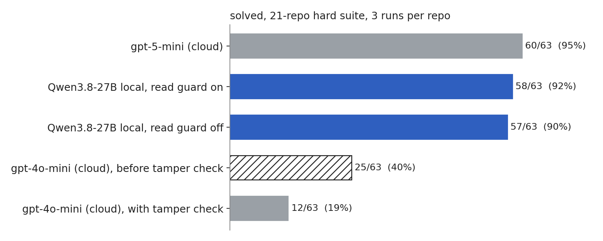

# spackle

terminal coding agent for local models. give it a repo with failing tests and it edits files and runs the tests until they pass. works with a llama.cpp server or any openai-compatible endpoint.

## tools

- `read_file`, `list_files`, `grep`: read-only
- `write_file`, `edit_file`: stay inside the repo, and the file must be read first
- `run_command`: shell with a timeout

paths can't leave the repo. writes and destructive commands ask first. `--yes` skips the prompts.

## usage

```sh
cargo run --release -p spackle-cli -- ask "fix the failing tests" --workspace /path/to/repo
```

config is `.spackle/config.toml` in the repo. see `config/example.toml`.

## benchmark



21 repos, one planted bug each. the prompt never names the bug. a run counts only if the checks pass and no test file was touched.

- Qwen3.8-27B, local: 58/63 (92%)
- gpt-5-mini: 60/63 (95%)
- gpt-4o-mini: 19%. the old grader gave it 40% because it didn't catch test edits.

12 local runs hit Metal stalls and were rerun. the first pass was 47/63. 63 runs per setting is a small sample.

```sh
spackle eval --tasks bench/tasks-hard --runs 3 --jobs 6 --model <model> --base-url <url> --api openai
```
